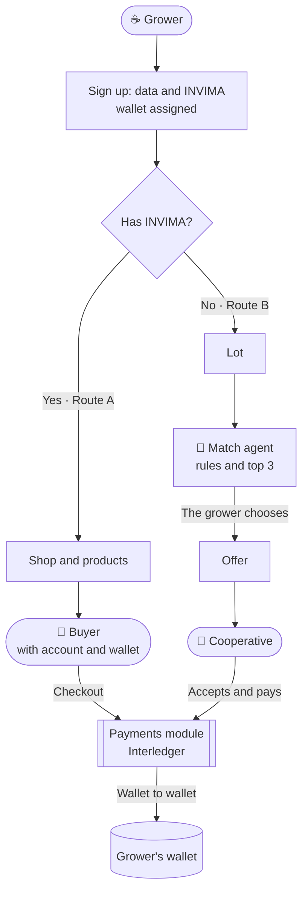
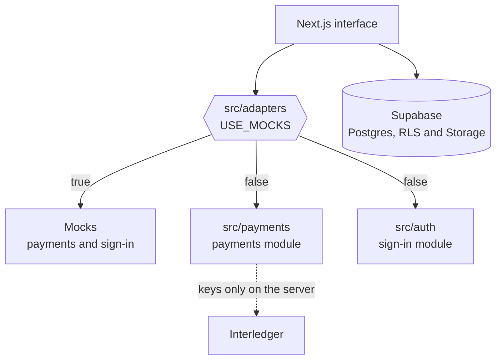

<p align="center">
  
</p>

# ☕ Terracierta by Onyx — Coffee with its own name

[🇪🇸 Español](./README.md) · **🇬🇧 English**


> A web platform that gives every small coffee grower in **Antioquia and Marsella** their own **wallet** to get paid directly with **Interledger**: by selling in their own online shop (if they have INVIMA, the Colombian food-safety registration) or to the best cooperative, recommended by an agent (if they don't).

**[🧾 AI usage log](./AI_USAGE.md)** · **[💬 Prompt log](./prompts/)** *(both written in Spanish)* · **[🇪🇸 Español](./README.md)**

> ℹ️ The app's interface and the project documents are in **Spanish**. In this file, button and screen names appear in Spanish with an English gloss.

> ⚠️ **Current status: demo.** Payments and sign-in are **simulated** (`USE_MOCKS=true`): no payment moves real money. The real payment module (`src/payments`) and the real accounts module (`src/auth`) belong to teammates and are **being integrated**; today `src/payments` and `src/auth` only contain plug-in points (see [Limitations and roadmap](#-limitations-and-roadmap)).

---

## 📑 Table of contents

- [✨ What it does](#-what-it-does)
- [🎯 Features](#-features)
- [🧩 Architecture](#-architecture)
- [🧰 Tech stack](#-tech-stack)
- [💸 How the money moves](#-how-the-money-moves)
- [🤖 How the agent decides](#-how-the-agent-decides)
- [🚀 Run locally](#-run-locally)
- [🌐 Deploy on Vercel](#-deploy-on-vercel)
- [📁 Project structure](#-project-structure)
- [🔐 Security](#-security)
- [🧭 AI use and transparency](#-ai-use-and-transparency)
- [🚧 Limitations and roadmap](#-limitations-and-roadmap)
- [👥 Team](#-team)
- [💡 About the hackathon](#-about-the-hackathon)

---

## ✨ What it does

**Starting hypothesis** *(to be validated with someone in the field)*: a small coffee grower has no direct, verifiable channel of their own to get paid. They depend on intermediaries who decide when and how they are paid, often with no receipt and no income history. And a grower without INVIMA cannot even open a shop.

Terracierta by Onyx addresses this in four steps:

1. **Sign in** with an account (grower, cooperative or buyer) and receive your **own wallet**: a payment address that any wallet can use to pay or to get paid.
2. **Your path** depends on whether you have INVIMA, a fact that is **stored with your account**: the app reads it and never asks again.
3. **Route A, with INVIMA:** open your shop, publish your products and get paid by each buyer straight into your wallet.
4. **Route B, without INVIMA:** upload your lot, pick one of the **3 best cooperatives** recommended by the agent, and the cooperative pays you through the platform.

Three entry points, depending on what each person is looking for:

| Who | What they do | Needs an account |
|-----|--------------|:----------------:|
| ☕ **Grower** | Sells in their shop or to a cooperative, and gets paid in their wallet | Yes |
| 🛒 **Buyer** | Browses the catalogue without an account; to **pay**, signs in and pays from their own wallet | To pay |
| 🏢 **Cooperative** | Receives offers for lots, accepts them and pays them | Yes |

---

## 🎯 Features

| Feature | Detail |
|---------|--------|
| 🧭 **Entry by role** | The home page lets you choose grower, buyer or cooperative and shows only what applies, with its main action (for the grower, creating an account) |
| 🏪 **Public shop** | Catalogue and detail page per grower, photos in Supabase Storage. Only published items are visible |
| 🛒 **Checkout with an account** | Paying requires signing in as a buyer: **the wallet comes from the profile**, not from a form. The catalogue stays public. **The amount and the grower's wallet are computed by the server** |
| 🧾 **My purchases** | The buyer sees their wallet, what they paid and the receipt for each purchase. Each account sees only its own |
| 💸 **Full payment cycle** | Request → authorization → execution → completion, with `pendiente / completado / fallido` states (pending / completed / failed) and a return route |
| 🧾 **Receipt** | Shared screen for orders and offers, refreshing automatically while a payment is pending |
| 🤖 **Match agent** | **Deterministic** score (no language model) over price, proximity, method, variety and capacity. Returns the top 3 with the reason |
| 📦 **Offer on choice** | The offer is created **only when the grower chooses**; seeing the top 3 commits nobody |
| 🏢 **Cooperative dashboard** | Offers to answer, to pay and history. Retry if a payment fails |
| 📊 **Payments dashboard** | The grower sees what was collected, completed payments and pending ones |
| 🔌 **Adapters with mocks** | Payments and sign-in go through a layer with a `USE_MOCKS` switch: the interface does not change when the real modules arrive |
| 🔒 **Layered security** | RLS on every table, server-side validation, sensitive writes only from the server |
| 🧾 **AI transparency** | A record of tools, files and prompts, as the event's policy requires |

---

## 🧩 Architecture



The interface never talks directly to the teammates' modules. Everything goes through **adapters**:



**Key decisions:**

- **The server decides the amount.** The browser only says *which product and how many units*; the price and the receiving wallet come from the database. Nobody can change the charge from the console.
- **Safe switch.** Mocks are enabled **only** with `USE_MOCKS=true`. If the variable is missing, the app uses the real modules: a forgotten deployment never silently simulates payments.
- **The database guarantees security.** RLS isolates each grower; the orders and payments tables have no write policies for users, only the server writes them.
- **The platform holds no money.** It shows the quote, asks for consent and leaves the receipt; the money goes wallet to wallet.
- **The agent uses rules only.** It is explainable and needs no keys. It is ready to evolve (for example, a model could write the "why") without changing the score.
- **Everyone has an account and a wallet to pay or get paid.** Growers, cooperatives **and buyers**. Browsing coffee needs no account; paying does, and the wallet used to pay comes from the profile (nobody can pay with someone else's wallet).

**Sign-in contract** (`src/adapters/types.ts`), with two distinct moments:

| Function | Input | Output | What it does |
|----------|-------|--------|--------------|
| `registrarse` *(sign up)* | `correo`, `contrasena`, `rol`, `nombre`, `municipio`, `tieneInvima` | `{ ok, rol }` or `{ ok: false, error }` | **Collects the data**, creates the account, **assigns the wallet**, saves the profile (INVIMA only for growers) and signs in |
| `iniciarSesion` *(sign in)* | `correo`, `contrasena` | `{ ok, rol }` or `{ ok: false, error }` | Only validates credentials; **everything else is detected automatically**. The error is generic (it does not reveal whether the email exists) |
| `obtenerSesion` / `obtenerPerfil` | — | session or profile with `wallet_address` and `tiene_invima` | The app only **reads** INVIMA; no screen changes it |
| `cerrarSesion` | — | — | — |

`Rol = caficultor | cooperativa | comprador` (grower | cooperative | buyer). The app sends users to `/acceso?siguiente=<route>` (or `/registro?...`) to return to the product they were about to pay for: the sign-in module must honor `siguiente` (internal routes only, already validated by `rutaSegura`).

---

## 🧰 Tech stack

| Layer | Technology | Role |
|-------|------------|------|
| Frontend + Backend | **Next.js 16** (App Router) | UI, Server Actions and Route Handlers |
| UI | **React 19** + **Tailwind CSS 4** | Components using the Terracierta tokens |
| Typefaces | **Cormorant Garamond** + **EB Garamond** | Headings and body, via `next/font` |
| Language | **TypeScript** (strict) | Typed across the whole project |
| Database and Storage | **Supabase** (PostgreSQL + RLS) | Data, row-level security and photos |
| Validation | **Zod 4** | Inputs validated on the server |
| Payments | **Interledger** | Wallet to wallet *(real module being integrated)* |
| Tests | **Vitest 4** + SQL | Unit, integration and RLS |
| Hosting and CI/CD | **Vercel** | Preview per branch and deploy on every push to `main` |

---

## 💸 How the money moves

```
Route A:  Buyer ── pays at checkout ──────────────▶ Grower's wallet
Route B:  Cooperative ── pays on accepting the offer ▶ Grower's wallet
```

The six technical steps of an Interledger payment, and what each does today:

| # | Step | Real module *(payments teammate)* | Current mock |
|:-:|------|:---------------------------------:|:------------:|
| 1 | Discover the grower's wallet | To be integrated | Simulated |
| 2 | Create the incoming payment | To be integrated | Simulated |
| 3 | Generate the quote | To be integrated | The exact amount is shown |
| 4 | Get the payer's consent | To be integrated | Simulated wallet screen |
| 5 | Execute the outgoing payment | To be integrated | ~3 s, then `completado` |
| 6 | Confirm the status and issue the receipt | To be integrated | Receipt `RCB-…` |

**Contract the app expects** (`src/adapters/types.ts`):

| Function | Input | Output |
|----------|-------|--------|
| `iniciarPago` | `tipo`, `referenciaId`, `montoCop`, `walletReceptor`, `walletPagador`, `urlRetorno` | `pagoId`, `redirectUrl` or `null`, `estado` |
| `consultarPago` | `pagoId` | `estado` (`pendiente`, `completado`, `fallido`), `detalle` |

The return route is `/pago/retorno?tipo=…&ref=…&pago_id=…`. If the wallet comes back without `pago_id`, it is resolved by `tipo` + `ref`.

---

## 🤖 How the agent decides

A score from **0 to 100**, computed in `src/lib/match.ts`, always the same for the same lot and the same cooperatives:

| Criterion | Max points | Rule |
|-----------|:----------:|------|
| 💰 Price per kg | 35 | Higher is better (the cooperative **pays** the grower) |
| 📍 Proximity | 25 | 100 % in the same municipality, dropping to 0 at 150 km |
| ⚙️ Method | 15 | Washed, honey or natural: does it accept it? |
| 🌱 Variety | 10 | Does it accept the lot's variety? |
| 📦 Capacity | 15 | Can it take the lot's kilos? |

A cooperative **can only be chosen** if it accepts the method and the variety and has capacity. If fewer than three qualify, the list is filled with those that don't, marked with the reason.

**Real example** *(500 kg of washed Caturra, Marsella, with the sample data)*:

| # | Cooperative | Score | Reason |
|:-:|-------------|:-----:|--------|
| I | Aroma del Suroeste | 88 | About 74 km away, pays the best price among the cooperatives |
| II | Cumbres Cafeteras | 87 | In the same municipality, pays COP 21,500 per kg |
| III | Raíz Alta | 59 | About 82 km away, the lowest price of the three |

*Tierra Nueva is left out: it does not accept the Caturra variety.*

> ⚠️ Proximity uses an **approximate** table of municipalities; if a municipality is missing, it is neutral. The weights are a first criterion and can be adjusted.

---

## 🚀 Run locally

**Requirements:** **Node 22** (`@supabase/supabase-js` 2.118 already requires it; on Node 20 there are warnings and the database tests use a `WebSocket` stand-in) and [Docker Desktop](https://www.docker.com/products/docker-desktop/) running.

```bash
# 1. Clone and install
git clone https://github.com/SalazarDukeImpactHub/terracierta-by-onyx.git
cd terracierta-by-onyx
npm install

# 2. Local database and Storage (applies migrations and sample data)
npx supabase start

# 3. Run the app at http://localhost:3000
npm run dev:local
```

> 💡 `dev:local` reads the **local** keys from `supabase status` and passes them only to the Next process. **You do not need to create any `.env` file.**

There are two distinct screens, as on any platform:

- **`/registro` (sign up):** asks for the person's data (role, name, municipality, email and password) and assigns their wallet. **Only growers** are asked whether they have INVIMA, and it is stored there. Cooperatives are preloaded and cannot sign up on their own.
- **`/acceso` (sign in):** asks only for **email and password**; the role, profile, wallet and INVIMA are detected automatically. It never asks for INVIMA again.

In demo mode, `/acceso` also lists five sample accounts (grower with INVIMA, grower without INVIMA, demo cooperative and two buyers, one whose payment always fails, to show that state) with the password `demo1234`, e.g. `marta@terracierta.demo`. They are made-up data, not secrets. Accounts you create at `/registro` in this mode do not store the password: it is a simulation to walk through the demo.

### 🧪 Try Route A (with INVIMA)

1. **Tienda** (Shop) → Marta Ospina's shop → a product → **Entrar para pagar** (Sign in to pay) → choose **Comprador (cuenta demo)**. You return to the same product, now with your wallet: **Pagar** (Pay).
2. In the simulated wallet, **Autorizar** (Authorize) or **Rechazar** (Reject).
3. The return screen shows the four steps and the receipt; the purchase appears under **Mis compras** (`/comprador`).
4. Sign in as Marta → **Pedidos y pagos recibidos** (Orders and payments received).
5. To see a failed payment, sign in as **Comprador cuyo pago falla (demo)** (Buyer whose payment fails): their wallet contains `fail`, and the mock makes their payment end in "No se pudo completar" (Could not be completed).

### 🧪 Try Route B (without INVIMA)

1. Sign in as **Caficultor sin INVIMA** (Jairo, Marsella) → **Cargar mi lote** (Upload my lot) → for example washed, Caturra, 500 kg, Marsella.
2. The agent shows the 3 cooperatives. **Choose Cumbres Cafeteras**: it is the one with a demo account.
3. Sign out and sign in as **Cooperativa (cuenta demo)** → **Aceptar oferta** (Accept offer) → **Pagar con Interledger** (Pay with Interledger) → authorize.
4. The receipt shows the payment from the cooperative's wallet to the grower's; the lot becomes *Vendido* (Sold).

### ✅ Tests

```bash
npm run typecheck   # types
npm test            # unit: validation, escaping, match agent, site URL
npm run test:db     # Route B and checkout integration against the local database (needs `supabase start`)
npm run test:rls    # RLS tests against the local database (recreates the database first)
npm run db:reset    # recreates the database from the migrations and the seed
```

Today: **115 tests** (86 unit and 29 integration) and **46 RLS checks**.

### 🔑 Environment variables

You only need them if you do not use `dev:local` (for example, to point at a cloud Supabase). **Never** commit them.

```env
USE_MOCKS=true                              # simulated payments and sign-in (until the real ones are integrated)
NEXT_PUBLIC_SUPABASE_URL=https://YOUR-PROJECT.supabase.co
NEXT_PUBLIC_SUPABASE_ANON_KEY=your-anon-key
SUPABASE_SERVICE_ROLE_KEY=your-service-role-key   # server only, never with the NEXT_PUBLIC prefix
# NEXT_PUBLIC_SITE_URL=http://localhost:3000    # optional: on Vercel it is taken from the deployment URL
```

The Interledger keys are defined by the payments module and live **only on the server**.

---

## 🌐 Deploy on Vercel

Vercel cannot reach the Supabase on your computer: you need a **cloud Supabase** project. A person with access to the accounts does this; **keys are typed only into the dashboards, never into the repo or into chats**.

1. **Supabase:** create a new project (one **owned by Terracierta**, do not reuse other teams' projects) and have the URL, the `anon key` and the `service_role key` at hand (*Project Settings → API*).
2. **Load the schema and the sample data:**
   ```bash
   npx supabase login
   npx supabase link --project-ref <PROJECT_REF>
   npx supabase db push --include-seed
   ```
   > 💡 If the CLI is signed in with **another** Supabase account and cannot see your project, you do not need to switch accounts: in the dashboard's *SQL Editor*, paste the 5 migrations from `supabase/migrations/` (in order) and then `supabase/seed.sql`. Every **new** migration is applied the same way, in order, in the cloud project.

   To **check** that it went well, run `supabase/tests/cloud-verify.sql` in the *SQL Editor*: it returns 15 rows with the expected value in parentheses (7 tables with RLS, 11 policies, 2 functions, 5 profiles, 4 cooperatives, 3 products, the `comprador` role, the photo bucket and the `anon` permissions).

   And to check the **behavior** of RLS (not just that it exists), run `supabase/tests/rls.sql` in the *SQL Editor* on a clean seed: 46 checks with six actors that end in `ROLLBACK`, so they leave no data behind. If everything is fine, it returns the row `RLS: todas las pruebas pasaron` (all tests passed).

   **Cloud scripts** (generated from the migrations and the seed, so they never go stale; they are written to `supabase/.temp/`, ignored by git):

   | Command | What it generates |
   |---------|-------------------|
   | `npm run cloud:setup` | Migrations + seed in one transaction, for a **new, empty** project (once) |
   | `npm run cloud:update -- <migration>` | **One new migration** (and its sample data) for a project that already has the previous ones. E.g.: `npm run cloud:update -- 20261017000000_comprador` |
   | `npm run cloud:reset` | Resets the **demo**: deletes the data in the 7 tables and reloads the seed. Does not touch the schema or the Storage photos |
3. **Vercel:** *Add New → Project* → import `SalazarDukeImpactHub/terracierta-by-onyx` (Next.js framework, root folder).
4. **Variables** (*Settings → Environment Variables*, in Production **and** Preview):

   | Variable | Value |
   |----------|-------|
   | `USE_MOCKS` | `true` (until the real payments and sign-in are integrated) |
   | `NEXT_PUBLIC_SUPABASE_URL` | Supabase project URL |
   | `NEXT_PUBLIC_SUPABASE_ANON_KEY` | `anon key` |
   | `SUPABASE_SERVICE_ROLE_KEY` | `service_role key` (mark it as *Sensitive*) |

5. **Redeploy.** New variables are not applied to existing deployments.

Every push to `main` updates production, and every branch or *pull request* gets its own preview URL.

> ⚠️ With `USE_MOCKS=true`, anyone who has the URL can sign in as one of the sample profiles and edit sample data. Keep Vercel's *Deployment Protection* on for previews and do not spread the public URL. When integrating the real modules: `USE_MOCKS=false`.

**Team workflow:** `main` is always deployable · every change goes on a short branch (`feat/…`, `fix/…`, `docs/…`) with a *pull request* · each teammate touches only their own folder (`src/payments`, `src/auth`).

- **`main` is protected:** it can only be changed through a *pull request* (no required reviews, so nobody is blocked), it does not accept *force push* and cannot be deleted. Vercel creates a *preview* URL for each branch.
- **`.github/CODEOWNERS`:** GitHub requests review automatically by folder: `src/payments/` → Yamil, `src/auth/` → Álvaro, and `src/adapters/types.ts` (the contract between the app and the two modules) → Jennifer, Yamil and Álvaro. Everything else is reviewed by Jennifer.

---

## 📁 Project structure

| Folder / file | What it contains |
|---------------|------------------|
| `src/app/` | Routes: home, sign in (`acceso`), sign up (`registro`), grower, shop, buyer, cooperative, payment and the payments API |
| `src/components/` | Header, footer, home role selector, brand bean, forms, receipt, product photos |
| `public/` | Brand logos (`brand/`: bean and seal, light and dark versions) and the home photo (`fotos/`) |
| `src/adapters/` | **Contracts** + mocks + the `USE_MOCKS` switch. The interface only talks to this layer |
| `src/payments/` | ⛔ **Stub** of the payments module *(payments teammate)* |
| `src/auth/` | ⛔ **Stub** of the sign-in and wallets module *(sign-in teammate)* |
| `src/lib/match.ts` | Match agent: score, breakdown and reason |
| `src/lib/ruta-b.ts` | Lot, cooperative choice, accepting an offer |
| `src/lib/roles.ts` | Each role's home and `rutaSegura` (where to return after signing in, internal routes only) |
| `src/lib/pagos-service.ts` | Create the payment from database data, sync status, orders and offers |
| `src/lib/validacion.ts` | Zod schemas, wallet address, safe URLs |
| `supabase/` | Migrations (tables, RLS, public view, Storage), `seed.sql` and `tests/rls.sql` |
| `scripts/` | `dev-local.mjs` and `test-db.mjs`: start with the local keys, no `.env`; `cloud-sql.mjs`: generates the SQL for the cloud |
| `AI_USAGE.md` · `prompts/` | The event's AI policy: tools, files and prompts |

---

## 🔐 Security

A platform that moves payments has to **pass its own audit**. Layers implemented and verified:

- **Amount and receiving wallet from the server.** A tampered request with fake `monto` and `walletReceptor` went out with the database price and the real wallet.
- **Row Level Security on all 7 tables.** Each grower sees and edits only their own; the public catalogue reads only `publicado = true`. **46 SQL checks** with six different actors (no session, grower, grower without INVIMA, cooperative and two buyers).
- **Sensitive writes only from the server.** Orders, payments and offers have no write policies for users.
- **Public view without wallets.** The shop is built from a view that exposes only `id`, `nombre` and `municipio`.
- **No INVIMA, no shop**, also at the database level. And INVIMA is **not self-declared from the app**: the fact comes from the account, so a grower cannot grant themselves shop access with one click.
- **Server-side validation.** Zod on every input; wallet address `https://` or `$`; bounded prices and quantities.
- **Escaped data.** HTML typed into names and descriptions is shown as text; photo URLs accept only `http(s)`.
- **Validated photos.** Type, size (2 MB) and the file's **real signature**: a text file disguised as a PNG is rejected.
- **Role protection.** No session → `/acceso`; each role sees only its own space; a grower cannot see another's lots; a buyer sees only their purchases.
- **Checkout with a session.** The payments API answers 401 without a session and 403 to growers and cooperatives; the wallet used to pay comes from the profile, so a wallet sent by the browser is ignored.
- **No open redirects.** The `siguiente` parameter accepts only internal routes: `https://…`, `//…` and `javascript:` are discarded, also on `/acceso` and `/registro`.
- **Signed simulated session.** In demo mode the session cookie is signed with a server secret: a bare id, an invented signature or another account's signature are rejected. It is still a simulation, not real authentication.
- **Bounded sign-up.** The role sent by the browser cannot be cooperative; INVIMA only counts if the role is grower; the password requires 8 characters or more; the sign-in error is the same for an unknown email and a wrong password.
- **Keys only on the server.** The service key does not appear in the browser bundle (verified) or in the repo.
- **No custody.** The platform never touches the money.

> Verified with SQL tests, integration tests against the database and browser walkthroughs. **It is not an external audit.**

---

## 🧭 AI use and transparency

We comply with the **event's AI Policy**: everything is recorded as the work happens, not at the end.

- **Tool:** *Claude Code* with the *Claude Sonnet 5.5* model wrote the app. **Jennifer Salazar Duke directs and reviews every decision.**
- **What the AI did not write:** the real Interledger service and the real sign-in belong to teammates; their files are listed separately.
- **Verification:** every task was run and tested, and the real result (including failures and their fixes) is in [`AI_USAGE.md`](./AI_USAGE.md).
- **Prompts:** the full text of each instruction, by area, in [`prompts/`](./prompts/).
- **Prior code:** no code was copied from other projects. The Luli shop was defined as a pattern reference and **nothing was opened or copied**.

---

## 🚧 Limitations and roadmap

| Pending | Status |
|---------|--------|
| Real payments with Interledger | Delivered by the payments teammate in `src/payments` |
| Real authentication (sign in / sign up) and wallet assignment | Delivered by the sign-in teammate in `src/auth`: `iniciarSesion` and `registrarse` (the app already has the `/acceso` and `/registro` screens) |
| Replace the provisional `profiles` table with the real one | When the sign-in is integrated. `tiene_invima` is **recorded at sign up** (growers only; the app only reads it) |
| `comprador` role and assigned wallet in the real sign-in | The sign-in teammate must allow `comprador` in `profiles.rol`, assign a wallet at sign up and honor `?siguiente=` (contract change) |
| Currency and minor units of the amount | To be confirmed with the payments module (today: whole COP) |
| Cooperatives without accounts | Only the **demo account** can accept and pay offers; the others are preloaded |
| Double payment with the real module | An abandoned pending payment is not cancelled: review when integrating |
| Agent: municipality coordinates | Approximate; the agent will evolve (for example, a model that writes the reason) |
| Cloud Supabase + public URL on Vercel | **Done** (with `USE_MOCKS=true`). Before presenting: `npm run cloud:reset` to leave the demo clean (see [Deploy](#-deploy-on-vercel)) |
| Demo-mode notice | Removed from the interface at the team's request: while payments and sign-in are simulated, **it must be said in the presentation** |
| Home photo | Its origin and license still need to be confirmed |
| Screenshots in the README | Added **at the end, with the final design** |
| Validation with someone in the field | Pending: how a grower gets paid today, how long it takes, whether they have Nequi |
| Repository license | To be defined by the team |

---

## 👥 Team

| Member | Role |
|--------|------|
| **Jennifer Salazar Duke** | Project direction, product and review |
| **Yamil Andre La Barrera López** | Payments with Interledger (`src/payments`) |
| **Álvaro Henao González** | Authentication (sign in / sign up) and wallet assignment (`src/auth`) |
| **Caren Briyid Hoyos Estrada** | Administration and creative side · ideas and error review |
| **Astrid Carolina Hoyos Estrada** | Administration and creative side · ideas and error review |

The technical work falls mostly on Yamil and Álvaro. Caren and Astrid handle **administration** and the **creative side**, contribute ideas and **review the app to catch the errors the technical team misses**.

> Each technical member works **only in their own folder** and on their own branch, with a *pull request* into `main`. Integrating the real modules goes through small, chained PRs, not a single one.

---

## 💡 About the hackathon

Built for the **Open Payments Hackathon · Medellín 2026** (Ruta N, October 16–17). The demo shows the full cycle: **payment request → authorization → execution → successful completion**, on both routes: a grower with INVIMA who publishes their coffee and receives a direct payment, and another without INVIMA who uploads a lot, chooses a cooperative and sees the payment.
