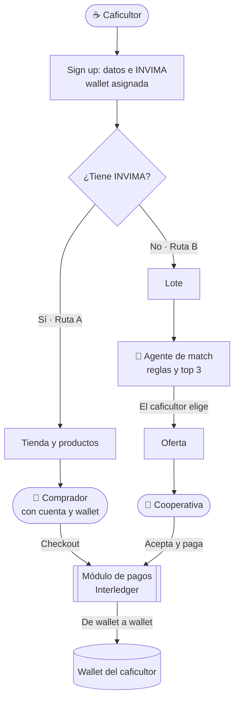
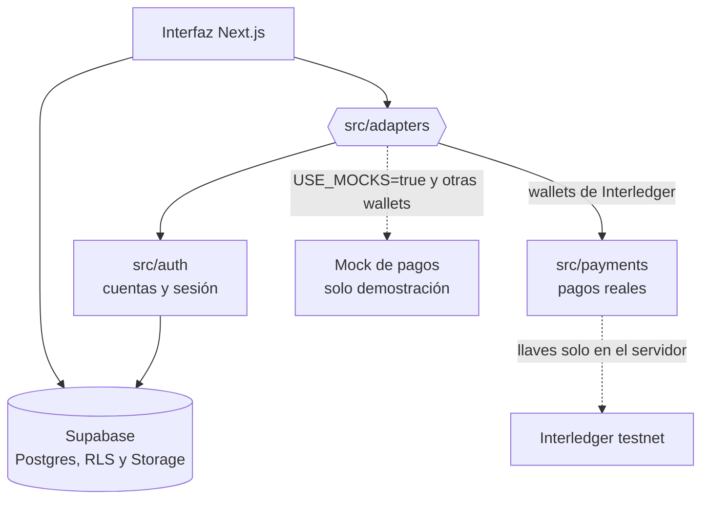

<p align="center">
  
</p>

# ☕ Terracierta by Onyx — Café con nombre propio

**🇪🇸 Español** · [🇬🇧 English](./README.en.md)


> Plataforma web que le da a cada pequeño caficultor de **Antioquia y Marsella** una **wallet propia** para cobrar directo con **Interledger**: vendiendo en su tienda virtual (con INVIMA) o a la mejor cooperativa que le recomienda un agente (sin INVIMA).

**[🧾 Registro de uso de IA](./AI_USAGE.md)** · **[💬 Registro de prompts](./prompts/)** · **[🇬🇧 English](./README.en.md)** · **[🎬 Video](#-video-de-la-demo)**

> ✅ **Estado actual: funcional sobre la billetera de prueba de Interledger.** El acceso es **real** (cuentas y sesión en Supabase) y los pagos se **ejecutan de verdad** contra la **testnet de Interledger**: mueven **fondos de prueba**, no dinero real. Los mocks (`USE_MOCKS=true`) son un modo demostración **opcional**, apagado cuando la variable falta. Para que una cuenta pague necesita una wallet de prueba y su token cargados en la base (ver [Cuentas y wallets](#-cuentas-y-wallets)). Pendientes y riesgos conocidos: [Limitaciones y roadmap](#-limitaciones-y-roadmap).

---

<!-- video:inicio -->
## 🎬 Video de la demo

[](https://www.youtube.com/watch?v=x2wtAdvquYA)

**[▶️ Ver el video en YouTube](https://www.youtube.com/watch?v=x2wtAdvquYA)**

---

<!-- video:fin -->

## 📑 Tabla de contenidos

- [🎬 Video de la demo](#-video-de-la-demo)
- [✨ Qué hace](#-qué-hace)
- [🎯 Funcionalidades](#-funcionalidades)
- [🧩 Arquitectura](#-arquitectura)
- [🧰 Stack tecnológico](#-stack-tecnológico)
- [💸 Cómo viaja el dinero](#-cómo-viaja-el-dinero)
- [🔑 Cuentas y wallets](#-cuentas-y-wallets)
- [🤖 Cómo decide el agente](#-cómo-decide-el-agente)
- [🚀 Correr localmente](#-correr-localmente)
- [🌐 Desplegar en Vercel](#-desplegar-en-vercel)
- [📁 Estructura del proyecto](#-estructura-del-proyecto)
- [🔐 Seguridad](#-seguridad)
- [🧭 Uso de IA y transparencia](#-uso-de-ia-y-transparencia)
- [🚧 Limitaciones y roadmap](#-limitaciones-y-roadmap)
- [👥 Equipo](#-equipo)
- [💡 Sobre el hackatón](#-sobre-el-hackatón)

---

## ✨ Qué hace

**Hipótesis de partida** *(a validar con alguien de campo)*: el pequeño caficultor no tiene un canal propio, directo y verificable para cobrar. Depende de intermediarios que fijan cuándo y cómo le pagan, muchas veces sin recibo ni historial de ingresos. Y quien no tiene INVIMA ni siquiera puede abrir una tienda.

Terracierta by Onyx lo resuelve en cuatro pasos:

1. **Ingrese** con su cuenta (caficultor, cooperativa o comprador). A cada cuenta se le asocia una **wallet de Interledger**: una dirección de cobro y de pago que cualquier billetera puede usar.
2. **Su camino** depende de si tiene INVIMA, un dato que queda **registrado con su cuenta**: la página lo lee y no se lo vuelve a preguntar.
3. **Ruta A, con INVIMA:** abra su tienda, publique sus productos y reciba el pago de cada comprador directo en su wallet.
4. **Ruta B, sin INVIMA:** cargue su lote, elija entre las **3 mejores cooperativas** que le recomienda el agente, y la cooperativa le paga por la plataforma.

Tres entradas, según lo que busca cada quien:

| Quién | Qué hace | Necesita cuenta |
|-------|----------|:---------------:|
| ☕ **Caficultor** | Vende en su tienda o a una cooperativa, y cobra en su wallet | Sí |
| 🛒 **Comprador** | Mira el catálogo sin cuenta; para **pagar** entra con su cuenta y paga desde su billetera | Para pagar |
| 🏢 **Cooperativa** | Recibe ofertas por lotes, las acepta y las paga | Sí |

---

## 🎯 Funcionalidades

| Función | Detalle |
|---------|---------|
| 🧭 **Entrada por rol** | El inicio deja elegir caficultor, comprador o cooperativa y muestra solo lo suyo, con su acción principal (para el caficultor, crear su cuenta) |
| 🏪 **Tienda pública** | Catálogo y detalle por caficultor, fotos en Supabase Storage. Solo se ve lo publicado |
| 🛒 **Checkout con cuenta** | Pagar exige iniciar sesión como comprador: **la wallet sale de su perfil**, no de un formulario. El catálogo sigue siendo público. **El monto y la wallet del caficultor los calcula el servidor** |
| 🧾 **Mis compras** | El comprador ve su wallet, lo que pagó y el recibo de cada compra. Cada cuenta ve solo las suyas |
| 💸 **Ciclo de pago completo** | Solicitud → autorización → ejecución → finalización, con estados `pendiente / completado / fallido` y ruta de retorno |
| 🧾 **Recibo** | Pantalla compartida para pedidos y ofertas, con refresco automático mientras el pago está pendiente |
| 🤖 **Agente de match** | Puntaje **determinista** (sin modelo de lenguaje) sobre precio, cercanía, método, variedad y capacidad. Devuelve el top 3 con el motivo |
| 📦 **Oferta al elegir** | La oferta se crea **solo cuando el caficultor elige**; ver el top 3 no compromete a nadie |
| 🏢 **Panel de la cooperativa** | Ofertas por responder, por pagar e historial. Reintento si el pago falla |
| 📊 **Panel de pagos** | El caficultor ve lo cobrado, los pagos completados y los pendientes |
| 🔐 **Acceso real** | Cuentas en Supabase (`usuarios`), contraseña guardada con hash y sesión en una cookie httpOnly respaldada por la tabla `sesiones` |
| 💳 **Pagos con Interledger** | De wallet a wallet sobre la testnet; el estado se confirma contra los movimientos de la billetera |
| 🛡️ **Canal post-cuántico** | Las llamadas de pago (`/api/pagos/*`) viajan cifradas con ML-KEM-768. La pasarela `/pago/pasarela` firma el recibo con Ed25519 + ML-DSA-65 |
| 🧪 **Modo demostración opcional** | `USE_MOCKS=true` agrega cuentas de ejemplo y una billetera simulada para ensayar sin mover fondos |
| 🔌 **Adaptadores** | Pagos y login pasan por una capa (`src/adapters`): la interfaz no habla directo con los módulos |
| 🔒 **Seguridad por capas** | RLS en todas las tablas, validación en el servidor, escrituras sensibles solo desde el servidor |
| 🧾 **Transparencia de IA** | Registro de herramientas, archivos y prompts, como pide la política del evento |

---

## 🧩 Arquitectura



La interfaz nunca habla directo con los módulos de pagos y de cuentas. Todo pasa por **adaptadores**:



**Decisiones clave:**

- **El servidor decide el monto.** El navegador solo dice *qué producto y cuántas unidades*; el precio y la wallet receptora salen de la base. Nadie puede cambiar el cobro desde la consola.
- **Los mocks solo se activan a propósito.** Únicamente con `USE_MOCKS=true`. Si la variable falta, la app usa los módulos reales: un despliegue olvidado no simula pagos en silencio. Ojo con el sentido contrario: hoy un pago entre dos wallets de Interledger es **real aunque** `USE_MOCKS` sea `true` (lo decide el dominio de la wallet). El [ADR-001](./docs/decisions/ADR-001-riel-de-pagos-y-politica-de-cooperativas.md) *(aceptado)* deja este riesgo registrado; una configuración explícita sigue pendiente.
- **La seguridad la garantiza la base.** El RLS aísla a cada caficultor; las tablas de pedidos y pagos no tienen políticas de escritura para usuarios, solo las escribe el servidor.
- **La plataforma no custodia dinero.** El pago va de wallet a wallet. En la pasarela (SDK oficial) el titular autoriza en su billetera; en el checkout de la tienda el pago sale con la sesión de la billetera de prueba guardada para esa cuenta (ver [Cómo viaja el dinero](#-cómo-viaja-el-dinero)).
- **El agente solo usa reglas.** Es explicable y no necesita llaves. Queda preparado para evolucionar (por ejemplo, que un modelo redacte el "por qué") sin cambiar el puntaje.
- **Todos tienen cuenta y wallet para pagar o cobrar.** Caficultores, cooperativas **y compradores**. Mirar el café no necesita cuenta; pagar sí, y la wallet con la que se paga sale del perfil (nadie puede pagar con una wallet ajena).

**Contrato con el login** (`src/adapters/types.ts`), con dos momentos distintos:

| Función | Entrada | Salida | Qué hace |
|---------|---------|--------|----------|
| `registrarse` *(sign up)* | `correo`, `contrasena`, `rol`, `nombre` (o `nombres` + `apellidos`), `tipo_documento`, `numero_documento`, `fecha_nacimiento`, `municipio`, `tieneInvima` | `{ ok, rol }` o `{ ok: false, error }` | Crea la cuenta y el perfil, guarda el INVIMA e inicia sesión. **No asigna wallet**: queda vacía hasta que se carga en la base (ver [Cuentas y wallets](#-cuentas-y-wallets)). Rechaza correo o documento repetidos |
| `iniciarSesion` *(sign in)* | `correo`, `contrasena` | `{ ok, rol }` o `{ ok: false, error }` | Solo valida credenciales; **todo lo demás se detecta solo**. El error es genérico (no revela si el correo existe) |
| `obtenerSesion` / `obtenerPerfil` | — | sesión o perfil con `wallet_address` y `tiene_invima` | La página solo **lee** el INVIMA; ninguna pantalla lo cambia |
| `cerrarSesion` | — | — | — |

`Rol = caficultor | cooperativa | comprador`. La página manda a `/acceso?siguiente=<ruta>` (o `/registro?...`) para volver al producto que se iba a pagar; `siguiente` solo admite rutas internas, validadas por `rutaSegura`.

---

## 🧰 Stack tecnológico

| Capa | Tecnología | Rol |
|------|------------|-----|
| Frontend + Backend | **Next.js 16** (App Router) | UI, Server Actions y Route Handlers |
| UI | **React 19** + **Tailwind CSS 4** | Componentes con los tokens de Terracierta |
| Tipografías | **Cormorant Garamond** + **EB Garamond** | Títulos y cuerpo, vía `next/font` |
| Lenguaje | **TypeScript** (strict) | Tipado en todo el proyecto |
| Base de datos y Storage | **Supabase** (PostgreSQL + RLS) | Datos, seguridad por fila y fotos |
| Validación | **Zod 4** | Entradas validadas en el servidor |
| Pagos | **Interledger** (Open Payments con SDK oficial y API de Test Wallet) | De wallet a wallet en la testnet |
| Criptografía post-cuántica | **@noble/post-quantum** + **@noble/curves** | ML-KEM-768 para el canal, ML-DSA-65 + Ed25519 para recibos |
| Pruebas | **Vitest 4** + SQL | Unitarias, integración y RLS |
| Hosting y CI/CD | **Vercel** | Preview por rama y deploy en cada push a `main` |

---

## 💸 Cómo viaja el dinero

```
Ruta A:  Comprador ── paga al comprar ──────────▶ Wallet del caficultor
Ruta B:  Cooperativa ── paga al aceptar la oferta ▶ Wallet del caficultor
```

Todo ocurre en la **testnet de Interledger**: el dinero es **de prueba**. Hoy hay **dos recorridos** de pago reales, que conviven:

| | Checkout de la tienda y ofertas | Pasarela (`/pago/pasarela`) |
|---|---|---|
| Código | `src/payments/index.ts` + `src/lib/interledger.ts` | `src/payments/openPayments.ts` (SDK oficial de Open Payments) |
| Cómo paga | Entra a la Test Wallet con la sesión guardada de la cuenta pagadora, cotiza y envía el pago saliente | Cotiza, pide un permiso GNAP y **el titular lo autoriza en su wallet**; después crea el pago saliente |
| Consentimiento | La sesión de billetera cargada para la cuenta | Explícito, del titular, en su wallet |
| Confirmación | Busca el movimiento en la billetera (`COMPLETED` / `FAILED`) | Observa el envío y la recepción con el SDK; recibo con firma híbrida |
| Topes de seguridad | 25 EUR por pago y 30 EUR de débito en la cotización (cuenta de prueba) | Monto recibido máximo configurable (`OPEN_PAYMENTS_MAX_RECEIVE`, 0,05 por defecto) |

El checkout valida en el servidor el monto, la wallet receptora y el rol; las llamadas a `/api/pagos/*` viajan por el canal cifrado ML-KEM-768. Si una wallet no es de Interledger y `USE_MOCKS=true`, el pago cae al mock y la pantalla lo declara como simulado.

> ⚠️ **Dos recorridos, un solo objetivo.** Tener dos rieles es una situación de integración, no un diseño final. El [ADR-001](./docs/decisions/ADR-001-riel-de-pagos-y-politica-de-cooperativas.md) *(aceptado)* fija el riel de cookie del checkout como oficial hoy y deja el SDK oficial como camino futuro. La guía de la pasarela está en [`docs/pasarela-hackathon.md`](./docs/pasarela-hackathon.md) y la demostración para el jurado en [`docs/demo-pqc-jurado.md`](./docs/demo-pqc-jurado.md).

**Contrato que espera la página** (`src/adapters/types.ts`):

| Función | Entrada | Salida |
|---------|---------|--------|
| `iniciarPago` | `tipo`, `referenciaId`, `montoCop`, `walletReceptor`, `walletPagador`, `urlRetorno` | `pagoId`, `redirectUrl` o `null`, `estado` |
| `consultarPago` | `pagoId` | `estado` (`pendiente`, `completado`, `fallido`), `detalle` |

La ruta de retorno es `/pago/retorno?tipo=…&ref=…&pago_id=…`. Si la billetera vuelve sin `pago_id`, se resuelve por `tipo` + `ref`.

---

## 🔑 Cuentas y wallets

- **Registro (`/registro`):** crea la cuenta (`usuarios`) y el perfil (`profiles`) y abre la sesión. **No asigna wallet**: `profiles.wallet_address` queda vacía.
- **Para que una cuenta pague o cobre con Interledger** hacen falta dos datos que hoy se **cargan a mano en la base**: la dirección de su wallet de prueba (`profiles.wallet_address`, de `interledger-test.dev`) y, para pagar desde ella, la sesión de la billetera (`usuarios.token`). El formulario de registro nunca escribe el token.
- **Datos de ejemplo (`seed.sql`):** sus wallets usan el dominio reservado `wallet.example.test`. Son **marcadores**, no billeteras de Interledger: con ellas el pago no es real. Hay que reemplazarlas por wallets de prueba para operar.
- **Sin wallet o con una wallet que no es de Interledger,** el pago real no se completa: con `USE_MOCKS=true` cae al mock y sin esa variable el pago no sale.
- **Cuenta de respaldo:** si el token de una cuenta venció o no existe, el módulo intenta entrar con `INTERLEDGER_EMAIL` / `INTERLEDGER_PASSWORD` (una cuenta compartida). El ADR-001 lo acepta como riesgo conocido del riel de cookie.

---

## 🤖 Cómo decide el agente

Puntaje de **0 a 100**, calculado en `src/lib/match.ts`, siempre igual para el mismo lote y las mismas cooperativas:

| Criterio | Puntos máximos | Regla |
|----------|:--------------:|-------|
| 💰 Precio por kg | 35 | Más alto es mejor (la cooperativa le **paga** al caficultor) |
| 📍 Cercanía | 25 | 100 % en el mismo municipio, baja hasta 0 a 150 km |
| ⚙️ Método | 15 | Lavado, honey o natural: ¿lo recibe? |
| 🌱 Variedad | 10 | ¿Recibe la variedad del lote? |
| 📦 Capacidad | 15 | ¿Le alcanza para los kilos del lote? |

Una cooperativa **solo se puede elegir** si acepta el método y la variedad y tiene capacidad. Si hay menos de tres, se completan con las que no calzan, marcadas con el motivo.

**Ejemplo real** *(lote de 500 kg Caturra lavado, Marsella, con los datos de ejemplo)*:

| # | Cooperativa | Puntaje | Motivo |
|:-:|-------------|:-------:|--------|
| I | Aroma del Suroeste | 88 | Queda a unos 74 km, paga el mejor precio entre las cooperativas |
| II | Cumbres Cafeteras | 87 | Está en el mismo municipio, paga $ 21.500 por kg |
| III | Raíz Alta | 59 | Queda a unos 82 km, el precio más bajo de las tres |

*Tierra Nueva queda afuera: no recibe la variedad Caturra.*

> ⚠️ La cercanía usa una tabla **aproximada** de municipios; si un municipio no está, queda neutra. Los pesos son un primer criterio y se pueden ajustar.

---

## 🚀 Correr localmente

**Requisitos:** **Node 22** (`@supabase/supabase-js` 2.118 ya lo pide; con Node 20 hay avisos y las pruebas de base de datos usan un reemplazo de `WebSocket`) y [Docker Desktop](https://www.docker.com/products/docker-desktop/) abierto.

```bash
# 1. Clonar e instalar
git clone https://github.com/SalazarDukeImpactHub/terracierta-by-onyx.git
cd terracierta-by-onyx
npm install

# 2. Base de datos y Storage locales (aplica migraciones y datos de ejemplo)
npx supabase start

# 3. Correr la página en http://localhost:3000
npm run dev:local
```

> 💡 `dev:local` lee las llaves **locales** de Supabase (`supabase status`) y se las pasa solo al proceso de Next. **No hace falta crear ningún `.env` para la base.** Los pagos reales sí necesitan las variables de Interledger (ver [Variables de entorno](#-variables-de-entorno)); sin ellas, ensaye con `USE_MOCKS=true`.

Hay dos pantallas distintas, como en cualquier plataforma:

- **`/registro` (sign up):** pide los datos de la persona (rol, nombre, documento, fecha de nacimiento, municipio, correo y contraseña), crea la cuenta y abre la sesión. Los caficultores declaran su INVIMA. Las cooperativas están precargadas y no se registran solas. **No asigna wallet** (ver [Cuentas y wallets](#-cuentas-y-wallets)).
- **`/acceso` (sign in):** pide solo **correo y contraseña**; el rol, el perfil, la wallet y el INVIMA se detectan solos. Nunca vuelve a preguntar el INVIMA.

Con `USE_MOCKS=true`, `/acceso` también lista cuentas de ejemplo con su correo y contraseña a la vista, y un botón de **entrada rápida**. Son datos inventados, no secretos, y **solo existen en modo demostración**. Las cuentas que cree en `/registro` sí se guardan, también en ese modo.

### 🧪 Probar la Ruta A (con INVIMA)

1. **Tienda** → una tienda (en la versión desplegada, la **Finca Henao** de Álvaro; con los datos de ejemplo locales, la de Marta Ospina) → un producto → **Entrar para pagar** → entre como comprador. Vuelve al mismo producto, ya con su wallet: **Pagar**.
2. **Modo demostración:** aparece la billetera simulada; **Autorizar** (o **Rechazar**). **Con wallets de Interledger cargadas:** no hay pantalla simulada, el pago se ejecuta contra la testnet y el retorno muestra su estado real.
3. La pantalla de retorno muestra los cuatro pasos y el recibo; en **Mis compras** (`/comprador`) queda la compra.
4. Entre como el dueño de la tienda (Álvaro en la versión desplegada; Marta con los datos de ejemplo) → **Pedidos y pagos recibidos**.
5. Para ver un pago fallido en modo demostración, entre como el comprador cuyo pago falla: su wallet contiene `fail` y el mock hace que termine en "No se pudo completar".

### 🧪 Probar la Ruta B (sin INVIMA)

1. Entre como **Caficultor sin INVIMA** (Jairo, Marsella) → **Cargar mi lote** → por ejemplo lavado, Caturra, 500 kg, Marsella.
2. El agente muestra las 3 cooperativas. **Elija Cumbres Cafeteras**: es la que tiene cuenta demo.
3. Salga y entre como **Cooperativa (cuenta demo)** → **Aceptar oferta** → **Pagar con Interledger**. En modo demostración se autoriza en la billetera simulada; con wallets reales el pago se ejecuta en la testnet.
4. El recibo muestra el pago de la wallet de la cooperativa a la del caficultor; el lote pasa a *Vendido*.

### ✅ Pruebas

```bash
npm run typecheck   # tipos
npm test            # unitarias y de pagos: validación, agente de match, canal PQC, pasarela
npm run test:db     # integración contra la base local (necesita `supabase start`)
npm run test:rls    # pruebas de RLS contra la base local (recrea la base antes de correr)
npm run db:reset    # recrea la base desde las migraciones y el seed
```

> ✅ **`npm test` pasa completo.** Las pruebas de pagos usan mocks: no prueban un pago real. El resultado de cada corrida se registra en [`AI_USAGE.md`](./AI_USAGE.md); aquí no se repiten cifras que puedan quedar viejas.

### 🔑 Variables de entorno

`dev:local` ya resuelve las de Supabase local. Las necesita escritas si apunta a un Supabase en la nube o si quiere pagos reales. **Nunca** las suba al repo; en Vercel se cargan en el panel.

| Grupo | Variable | Para qué |
|-------|----------|----------|
| Modo | `USE_MOCKS` | `true` activa la demostración simulada. Si falta, no hay mocks |
| Supabase | `NEXT_PUBLIC_SUPABASE_URL` | URL del proyecto |
| | `NEXT_PUBLIC_SUPABASE_ANON_KEY` *(o* `NEXT_PUBLIC_SUPABASE_PUBLISHABLE_KEY`*)* | Llave pública |
| | `SUPABASE_SERVICE_ROLE_KEY` *(o* `SUPABASE_SECRET_KEY`*)* | Llave de servidor. **Nunca** con prefijo `NEXT_PUBLIC` |
| Sitio | `NEXT_PUBLIC_SITE_URL` | Opcional. En Vercel se toma de la URL del despliegue |
| Checkout (Test Wallet) | `INTERLEDGER_API_URL` | Opcional; por defecto `https://api-wallet.interledger-test.dev` |
| | `INTERLEDGER_EMAIL`, `INTERLEDGER_PASSWORD` | Cuenta de respaldo si una cuenta no tiene token vigente |
| Pasarela (SDK oficial) | `OPEN_PAYMENTS_CLIENT_WALLET`, `OPEN_PAYMENTS_KEY_ID` | Wallet y llave del cliente de Open Payments |
| | `OPEN_PAYMENTS_PRIVATE_KEY` *(o* `OPEN_PAYMENTS_PRIVATE_KEY_PATH`*)* | Llave privada. Solo servidor |
| | `OPEN_PAYMENTS_SENDER_WALLET` | Wallet que paga en la demostración |
| | `OPEN_PAYMENTS_MAX_RECEIVE`, `OPEN_PAYMENTS_MAX_DEBIT` | Topes del cobro |
| | `OPEN_PAYMENTS_REDIRECT_ORIGIN` | Origen al que vuelve el titular tras autorizar |
| | `PAYMENTS_RAIL` | Solo admite `open-payments` (el valor por defecto) |
| | `PAYMENTS_EXECUTION_ENABLED` | `false` bloquea la ejecución y deja solo consultar el total |
| | `PASARELA_DEMO_ENABLED` | Habilita la pasarela de demostración |

Las llaves de Interledger viven **solo en el servidor**.

---

## 🌐 Desplegar en Vercel

Vercel no puede llegar al Supabase de su computador: hace falta un proyecto de **Supabase en la nube**. Lo hace una persona con acceso a las cuentas; **las llaves se escriben solo en los paneles, nunca en el repo ni en chats**.

1. **Supabase:** cree un proyecto nuevo (uno **propio de Terracierta**, no reutilice proyectos de otros equipos) y tenga a mano la URL, la `anon key` y la `service_role key` (*Project Settings → API*).
2. **Cargar el esquema y los datos de ejemplo:**
   ```bash
   npx supabase login
   npx supabase link --project-ref <REF_DEL_PROYECTO>
   npx supabase db push --include-seed
   ```
   > 💡 Si la CLI está iniciada con **otra cuenta** de Supabase y no ve su proyecto, no hace falta cambiar de cuenta: en el *SQL Editor* del dashboard pegue las migraciones de `supabase/migrations/` (en orden) y luego `supabase/seed.sql`. Cada migración **nueva** se aplica igual, en orden, en el proyecto de la nube.

   Para **comprobar** que quedó bien, ejecute `supabase/tests/cloud-verify.sql` en el *SQL Editor*: devuelve una fila por comprobación con el valor esperado entre paréntesis (tablas con RLS, políticas, funciones, perfiles del seed, el bucket de fotos y los permisos de `anon`). Si agregó migraciones después de esa prueba, revise que sus números sigan vigentes.

   Y para comprobar el **comportamiento** del RLS (no solo que exista), ejecute `supabase/tests/rls.sql` en el *SQL Editor* con el seed limpio: las verificaciones terminan en `ROLLBACK`, así que no dejan datos. Si todo está bien, devuelve la fila `RLS: todas las pruebas pasaron`.

   **Scripts para la nube** (se generan desde las migraciones y el seed, así nunca quedan desactualizados; salen en `supabase/.temp/`, ignorada por git):

   | Comando | Qué genera |
   |---------|------------|
   | `npm run cloud:setup` | Migraciones + seed en una transacción, para un proyecto **nuevo y vacío** (una sola vez) |
   | `npm run cloud:update -- <migración>` | **Una migración nueva** (y sus datos de ejemplo) para un proyecto que ya tiene las anteriores. Ej.: `npm run cloud:update -- 20261017000000_comprador` |
   | `npm run cloud:reset` | Reinicia la **demo**: borra los datos de las 7 tablas y recarga el seed. No toca el esquema ni las fotos de Storage |
3. **Vercel:** *Add New → Project* → importe `SalazarDukeImpactHub/terracierta-by-onyx` (framework Next.js, carpeta raíz).
4. **Variables** (*Settings → Environment Variables*, en Production **y** Preview):

   | Variable | Valor |
   |----------|-------|
   | `NEXT_PUBLIC_SUPABASE_URL` | URL del proyecto de Supabase |
   | `NEXT_PUBLIC_SUPABASE_ANON_KEY` | `anon key` |
   | `SUPABASE_SERVICE_ROLE_KEY` | `service_role key` (márquela como *Sensitive*) |
   | Variables de Interledger | Las de la [tabla de variables](#-variables-de-entorno), según use el checkout, la pasarela o ambos (las llaves, como *Sensitive*) |
   | `USE_MOCKS` | **No la defina para pagos reales.** Póngala en `true` solo si quiere un despliegue de demostración simulada |

5. **Redeploy.** Las variables nuevas no se aplican a despliegues ya hechos.

Cada push a `main` actualiza producción y cada rama o *pull request* genera su propia URL de preview.

> ⚠️ Con `USE_MOCKS=true`, cualquiera que tenga la URL puede entrar como uno de los perfiles de ejemplo (hay botón de entrada rápida) y editar datos de ejemplo. Deje activa la *Deployment Protection* de Vercel en los previews. Para un despliegue con pagos reales, quite la variable.

**Flujo de trabajo del equipo:** `main` siempre desplegable · cada cambio en una rama corta (`feat/…`, `fix/…`, `docs/…`) con *pull request* · cada compañero toca solo su carpeta (`src/payments`, `src/auth`).

- **`main` está protegida:** solo se entra por *pull request* (no se aprueba con revisiones obligatorias, para no frenar a nadie), no admite *force push* y no se puede borrar. Vercel genera una URL de *preview* por cada rama.
- **`.github/CODEOWNERS`:** GitHub pide revisión automáticamente según la carpeta: `src/payments/` → Yamil, `src/auth/` → Álvaro, y `src/adapters/types.ts` (el contrato entre la página y los dos módulos) → Jennifer, Yamil y Álvaro. Todo lo demás lo revisa Jennifer.

---

## 📁 Estructura del proyecto

| Carpeta / archivo | Qué contiene |
|-------------------|--------------|
| `src/app/` | Rutas: inicio, acceso (sign in), registro (sign up), caficultor, tienda, comprador, cooperativa, pago (retorno, pasarela, seguridad) y APIs de pagos y pasarela |
| `src/components/` | Cabecera, pie, selector de rol del inicio, grano de la marca, formularios, recibo, fotos de producto |
| `public/` | Logos de la marca (`brand/`: grano y sello, versión clara y oscura) y la foto del inicio (`fotos/`) |
| `src/adapters/` | **Contratos** + mocks + selector `USE_MOCKS`. La interfaz solo habla con esta capa |
| `src/payments/` | Módulo de pagos *(Yamil)*: checkout, pasarela con SDK oficial, canal y recibos post-cuánticos (`pqc/`) |
| `src/auth/` | Módulo de cuentas *(Álvaro)*: registro, acceso y sesión; la lógica de sesión está en `src/lib/sesion.ts` |
| `src/lib/interledger.ts` | Cliente de la API de Test Wallet: cotizar, enviar y confirmar pagos del checkout |
| `docs/` | Pasarela, demostración para el jurado, ADR-001 (aceptado), planes de integración e investigación de PQC |
| `src/lib/match.ts` | Agente de match: puntaje, desglose y motivo |
| `src/lib/ruta-b.ts` | Lote, elección de cooperativa, aceptar oferta |
| `src/lib/roles.ts` | Home de cada rol y `rutaSegura` (a dónde volver tras entrar, solo rutas internas) |
| `src/lib/pagos-service.ts` | Crear el pago desde datos de la base, sincronizar estado, pedidos y ofertas |
| `src/lib/validacion.ts` | Esquemas Zod, wallet address, URLs seguras |
| `supabase/` | Migraciones (tablas, RLS, vista pública, Storage), `seed.sql` y `tests/rls.sql` |
| `scripts/` | `dev-local.mjs` y `test-db.mjs`: arrancan con las llaves locales, sin `.env`; `cloud-sql.mjs`: genera el SQL para la nube |
| `AI_USAGE.md` · `prompts/` | Política de IA del evento: herramientas, archivos y prompts |

---

## 🔐 Seguridad

Una plataforma que mueve cobros tiene que **pasar su propia auditoría**. Capas implementadas y verificadas:

- **Monto y wallet receptora desde el servidor.** Una petición manipulada con `monto` y `walletReceptor` falsos salió con el precio de la base y la wallet real.
- **Row Level Security en las tablas de negocio.** Cada caficultor ve y edita solo lo suyo; el catálogo público lee solo `publicado = true`. Verificaciones en SQL (`supabase/tests/rls.sql`) con actores distintos: sin sesión, caficultores, cooperativa y compradores.
- **Escrituras sensibles solo desde el servidor.** Pedidos, pagos y ofertas no tienen políticas de escritura para usuarios.
- **Vista pública sin wallets.** La tienda se arma con una vista que expone solo `id`, `nombre` y `municipio`.
- **Sin INVIMA no se abre tienda**, también a nivel de base de datos. Y el INVIMA **no se autodeclara desde la página**: el dato viene de la cuenta, así que un caficultor no puede darse acceso a la tienda con un clic.
- **Validación en el servidor.** Zod en cada entrada; wallet address `https://` o `$`; precios y cantidades acotados.
- **Datos escapados.** El HTML escrito en nombres y descripciones se muestra como texto; las URLs de foto solo aceptan `http(s)`.
- **Fotos validadas.** Tipo, tamaño (2 MB) y **firma real del archivo**: un texto disfrazado de PNG se rechaza.
- **Protección por rol.** Sin sesión → `/acceso`; cada rol solo ve su espacio; un caficultor no ve los lotes de otro; un comprador solo ve sus compras.
- **Checkout con sesión.** La API de pagos responde 401 sin sesión y 403 a caficultores; la wallet con la que se paga sale del perfil, así que una wallet que mande el navegador se ignora. Hoy el checkout admite compradores **y** cooperativas; esa es la política vigente (ADR-001, aceptado).
- **Canal cifrado post-cuántico.** Las llamadas de pago viajan con ML-KEM-768 + AES-256-GCM; la pasarela añade un token de un solo uso ligado a sesión y cotización, con vencimiento de cinco minutos. El cifrado protege el tramo navegador–servidor: **no autoriza** pagos ni vuelve post-cuántico a Interledger.
- **Topes en la cuenta de prueba.** El checkout rechaza pagos de más de 25 EUR o cotizaciones que debiten más de 30 EUR.
- **Sin redirecciones abiertas.** El parámetro `siguiente` solo acepta rutas internas: `https://…`, `//…` y `javascript:` se descartan, también en `/acceso` y `/registro`.
- **Sesión real en cookie httpOnly.** El id de sesión es aleatorio (64 hex), vive en la tabla `sesiones` con vencimiento a 7 días, la cookie es `httpOnly`, `sameSite=lax` y `secure` en producción. Un id con otro formato se descarta sin consultar la base.
- **Contraseñas con hash** y el mismo error de sign in para correo desconocido y contraseña errónea. El registro rechaza correo o documento repetidos.
- **Llaves solo en el servidor.** La llave de servicio no aparece en el bundle del navegador (verificado) ni en el repo.
- **Sin custodia.** La plataforma nunca toca el dinero.

> Verificado con pruebas en SQL, pruebas de integración contra la base y recorridos en el navegador. **No es una auditoría externa.**

---

## 🧭 Uso de IA y transparencia

Cumplimos la **Política de IA del evento**: todo está registrado mientras se trabaja, no al final.

- **Herramienta:** *Claude Code* con el modelo *Claude Sonnet 5.5* escribió la página completa. **Jennifer Salazar Duke dirige y revisa cada decisión.**
- **Qué no escribió la IA de Jennifer:** los módulos de pagos (`src/payments`) y de cuentas (`src/auth`) son de los compañeros; sus archivos se listan aparte.
- **Verificación:** cada tarea se corrió y probó, y el resultado real (incluidos los fallos y sus correcciones) está en [`AI_USAGE.md`](./AI_USAGE.md).
- **Prompts:** el texto íntegro de cada instrucción, por área, en [`prompts/`](./prompts/).
- **Código previo:** no se copió código de otros proyectos. La tienda de Luli se definió como referencia de patrones y **no se abrió ni se copió nada**.

---

## 🚧 Limitaciones y roadmap

| Pendiente | Estado |
|-----------|--------|
| Dos recorridos de pago (checkout con la API de Test Wallet y pasarela con SDK oficial y GNAP) | Conviven. [ADR-001](./docs/decisions/ADR-001-riel-de-pagos-y-politica-de-cooperativas.md) *(aceptado)*: el riel oficial es el de cookie del checkout; la pasarela con SDK y GNAP queda como futuro hasta que persista su estado |
| Pago real sin consentimiento explícito en el checkout | El checkout paga con la sesión de billetera guardada de la cuenta (o la de respaldo `INTERLEDGER_EMAIL`); la pasarela sí pide la autorización del titular |
| Asignación de wallets | El registro **no asigna** wallet ni token: se cargan a mano en la base. Falta definir cómo se asignan |
| Datos de ejemplo con wallets marcador | `seed.sql` usa `wallet.example.test`: no son billeteras de Interledger |
| `tiene_invima` duplicado | El registro lo guarda en `usuarios` y en `profiles`; falta definir la fuente única |
| Moneda y unidades menores del monto | Los precios están en COP y la wallet de prueba cobra en EUR: se convierte con la tasa de la Test Wallet y se aplican topes |
| Política de cooperativas | Hoy el checkout admite cooperativas como compradoras, sin pantalla de compras propia; esa política está aceptada en el ADR-001; las cooperativas con cuenta son datos de ejemplo |
| Doble pago con el módulo real | Un pago pendiente abandonado no se cancela: revisar |
| Estado de la pasarela en serverless | Según la documentación de la pasarela, sus grants y llaves viven en memoria de un proceso: en Vercel (serverless) el flujo completo puede no cerrarse. Falta validarlo con login real |
| Pruebas | La suite pasa completa. Las de pagos usan mocks: no prueban un pago real |
| Agente: coordenadas de municipios | Aproximadas; el agente evolucionará (por ejemplo, un modelo que redacte el motivo) |
| Supabase en la nube + URL pública en Vercel | **Hecho.** Antes de presentar, revise las variables del despliegue ([Desplegar](#-desplegar-en-vercel)). `npm run cloud:reset` borra datos: confirme qué tablas toca (hay tablas nuevas, como `usuarios` y `sesiones`) antes de correrlo |
| Aviso de modo demostración | Se quitó de la interfaz a pedido del equipo. Con pagos reales ya no aplica; **si se despliega con `USE_MOCKS=true`, hay que decir en la presentación que los pagos son simulados** |
| Uso de IA de los compañeros | Falta declararlo en [`AI_USAGE.md`](./AI_USAGE.md) |
| Foto del inicio | Generada por Jennifer Salazar Duke con la creación de imágenes de ChatGPT (OpenAI). El prompt está en [`prompts/foto-inicio.md`](./prompts/foto-inicio.md) y la declaración en [`AI_USAGE.md`](./AI_USAGE.md) |
| Capturas de pantalla en el README | Se agregan **al final, con el diseño definitivo** |
| Validación con alguien de campo | Pendiente: cómo cobra hoy el caficultor, cuánto tarda, si tiene Nequi |
| Licencia del repositorio | Por definir por el equipo |

---

## 👥 Equipo

| Integrante | Rol |
|------------|-----|
| **Jennifer Salazar Duke** | Dirección del proyecto, producto y revisión |
| **Yamil Andre La Barrera López** | Pagos con Interledger (`src/payments`) |
| **Álvaro Henao González** | Autenticación (sign in / sign up) y asignación de wallets (`src/auth`) |
| **Caren Briyid Hoyos Estrada** | Administración y parte creativa · ideas y revisión de errores |
| **Astrid Carolina Hoyos Estrada** | Administración y parte creativa · ideas y revisión de errores |

Lo técnico recae sobre todo en Yamil y Álvaro. Caren y Astrid llevan la **administración** y la **parte creativa**, aportan ideas y **revisan la app para detectar los errores que se le escapen al equipo técnico**.

> Cada integrante técnico trabaja **solo en su carpeta** y en su propia rama, con *pull request* hacia `main`. La integración de los módulos reales va en PRs pequeños y encadenados, no en uno solo.

---

## 💡 Sobre el hackatón

Proyecto construido para el **Hackatón Open Payments · Medellín 2026** (Ruta N, 16 y 17 de octubre). La demo muestra el ciclo completo: **solicitud de pago → autorización → ejecución → finalización exitosa**, en las dos rutas: un caficultor con INVIMA que publica su café y recibe un pago directo, y otro sin INVIMA que carga su lote, elige una cooperativa y ve el cobro. Los pagos se ejecutan en la **testnet de Interledger**, con fondos de prueba.
