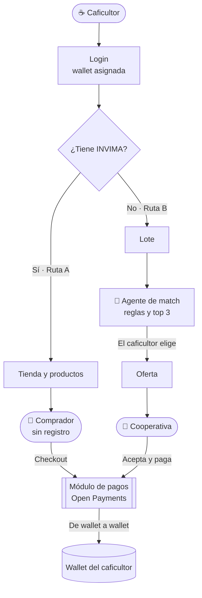
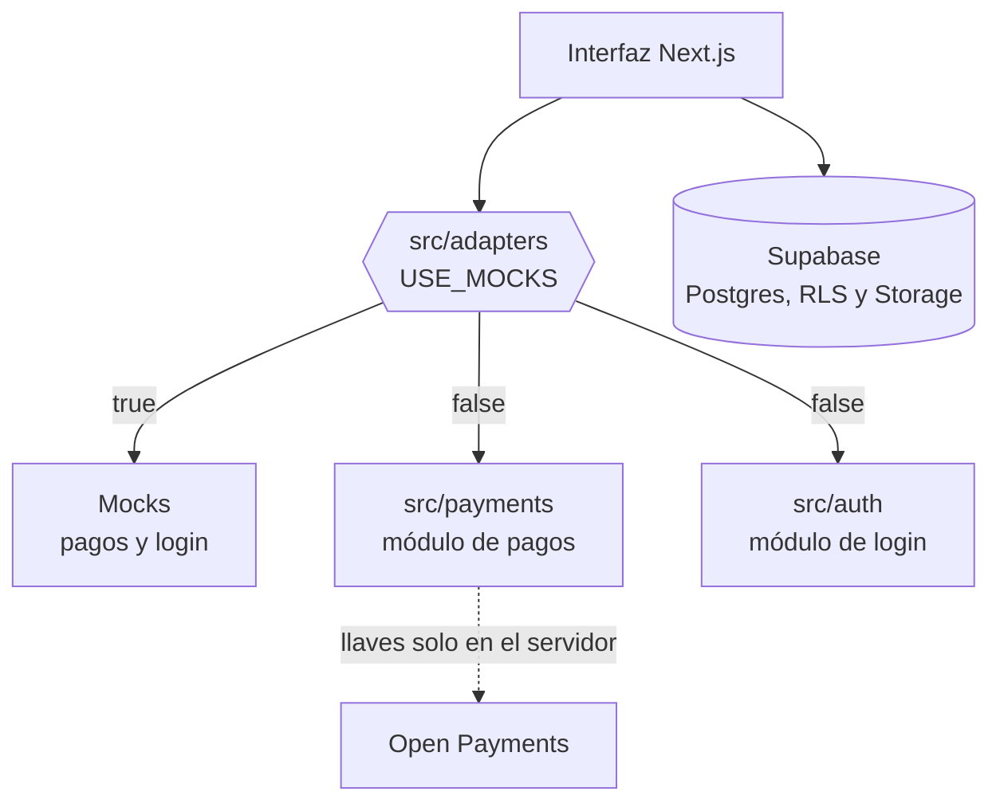

# ☕ Terracierta by Onyx — Café con nombre propio


> Plataforma web que le da a cada pequeño caficultor de **Antioquia y Marsella** una **wallet propia** para cobrar directo con **Open Payments**: vendiendo en su tienda virtual (con INVIMA) o a la mejor cooperativa que le recomienda un agente (sin INVIMA).

**[🌿 Conozca Terracierta](https://terracierta-landing.vercel.app/)** · **[🧾 Registro de uso de IA](./AI_USAGE.md)** · **[💬 Registro de prompts](./prompts/)**

---

## 📑 Tabla de contenidos

- [✨ Qué hace](#-qué-hace)
- [🎯 Funcionalidades](#-funcionalidades)
- [🧩 Arquitectura](#-arquitectura)
- [🧰 Stack tecnológico](#-stack-tecnológico)
- [💸 Cómo viaja el dinero](#-cómo-viaja-el-dinero)
- [🤖 Cómo decide el agente](#-cómo-decide-el-agente)
- [🚀 Correr localmente](#-correr-localmente)
- [🌐 Desplegar en Vercel](#-desplegar-en-vercel)
- [📁 Estructura del proyecto](#-estructura-del-proyecto)
- [🔐 Seguridad](#-seguridad)
- [🧭 Uso de IA y transparencia](#-uso-de-ia-y-transparencia)
- [🚧 Limitaciones y roadmap](#-limitaciones-y-roadmap)
- [👥 Equipo](#-equipo)
- [💡 Sobre el hackatón](#-sobre-el-hackatón)

---

## ✨ Qué hace

**Hipótesis de partida** *(a validar con alguien de campo)*: el pequeño caficultor no tiene un canal propio, directo y verificable para cobrar. Depende de intermediarios que fijan cuándo y cómo le pagan, muchas veces sin recibo ni historial de ingresos. Y quien no tiene INVIMA ni siquiera puede abrir una tienda.

Terracierta by Onyx lo resuelve en cuatro pasos:

1. **Ingrese** como caficultor y reciba su **wallet propia**: una dirección de cobro que cualquier billetera puede pagar.
2. **Declare** si tiene INVIMA. De eso depende su camino.
3. **Ruta A, con INVIMA:** abra su tienda, publique sus productos y reciba el pago de cada comprador directo en su wallet.
4. **Ruta B, sin INVIMA:** cargue su lote, elija entre las **3 mejores cooperativas** que le recomienda el agente, y la cooperativa le paga por la plataforma.

Tres entradas, según lo que busca cada quien:

| Quién | Qué hace | Necesita cuenta |
|-------|----------|:---------------:|
| ☕ **Caficultor** | Vende en su tienda o a una cooperativa, y cobra en su wallet | Sí |
| 🛒 **Comprador** | Compra en la tienda pública y paga desde su billetera | No |
| 🏢 **Cooperativa** | Recibe ofertas por lotes, las acepta y las paga | Sí |

---

## 🎯 Funcionalidades

| Función | Detalle |
|---------|---------|
| 🏪 **Tienda pública** | Catálogo y detalle por caficultor, fotos en Supabase Storage. Solo se ve lo publicado |
| 🛒 **Checkout sin registro** | El comprador solo indica su wallet address. **El monto y la wallet del caficultor los calcula el servidor** |
| 💸 **Ciclo de pago completo** | Solicitud → autorización → ejecución → finalización, con estados `pendiente / completado / fallido` y ruta de retorno |
| 🧾 **Recibo** | Pantalla compartida para pedidos y ofertas, con refresco automático mientras el pago está pendiente |
| 🤖 **Agente de match** | Puntaje **determinista** (sin modelo de lenguaje) sobre precio, cercanía, método, variedad y capacidad. Devuelve el top 3 con el motivo |
| 📦 **Oferta al elegir** | La oferta se crea **solo cuando el caficultor elige**; ver el top 3 no compromete a nadie |
| 🏢 **Panel de la cooperativa** | Ofertas por responder, por pagar e historial. Reintento si el pago falla |
| 📊 **Panel de pagos** | El caficultor ve lo cobrado, los pagos completados y los pendientes |
| 🔌 **Adaptadores con mocks** | Pagos y login pasan por una capa con interruptor `USE_MOCKS`: la interfaz no cambia cuando llegan los módulos reales |
| 🔒 **Seguridad por capas** | RLS en todas las tablas, validación en el servidor, escrituras sensibles solo desde el servidor |
| 🧾 **Transparencia de IA** | Registro de herramientas, archivos y prompts, como pide la política del evento |

---

## 🧩 Arquitectura



La interfaz nunca habla directo con los módulos de los compañeros. Todo pasa por **adaptadores**:



**Decisiones clave:**

- **El servidor decide el monto.** El navegador solo dice *qué producto y cuántas unidades*; el precio y la wallet receptora salen de la base. Nadie puede cambiar el cobro desde la consola.
- **Interruptor seguro.** Los mocks se activan **solo** con `USE_MOCKS=true`. Si la variable falta, la app usa los módulos reales: un despliegue olvidado no simula pagos en silencio.
- **La seguridad la garantiza la base.** El RLS aísla a cada caficultor; las tablas de pedidos y pagos no tienen políticas de escritura para usuarios, solo las escribe el servidor.
- **La plataforma no custodia dinero.** Muestra la cotización, pide el consentimiento y deja el recibo; el dinero va de wallet a wallet.
- **El agente solo usa reglas.** Es explicable y no necesita llaves. Queda preparado para evolucionar (por ejemplo, que un modelo redacte el "por qué") sin cambiar el puntaje.

---

## 🧰 Stack tecnológico

| Capa | Tecnología | Rol |
|------|------------|-----|
| Frontend + Backend | **Next.js 16** (App Router) | UI, Server Actions y Route Handlers |
| UI | **React 19** + **Tailwind CSS 4** | Componentes con los tokens de Terracierta |
| Tipografías | **Cormorant Garamond** + **EB Garamond** | Títulos y cuerpo, vía `next/font` |
| Lenguaje | **TypeScript** (strict) | Tipado en todo el proyecto |
| Base de datos y Storage | **Supabase** (PostgreSQL + RLS) | Datos, seguridad por fila y fotos |
| Validación | **Zod 4** | Entradas validadas en el servidor |
| Pagos | **Open Payments** | De wallet a wallet *(módulo real en integración)* |
| Pruebas | **Vitest 4** + SQL | Unitarias, integración y RLS |
| Hosting y CI/CD | **Vercel** | Preview por rama y deploy en cada push a `main` |

---

## 💸 Cómo viaja el dinero

```
Ruta A:  Comprador ── paga al comprar ──────────▶ Wallet del caficultor
Ruta B:  Cooperativa ── paga al aceptar la oferta ▶ Wallet del caficultor
```

Los seis pasos técnicos de un pago con Open Payments, y qué hace cada uno hoy:

| # | Paso | Módulo real *(compañero de pagos)* | Mock actual |
|:-:|------|:-----------------------------------:|:-----------:|
| 1 | Descubrir la wallet del caficultor | Pendiente de integrar | Simulado |
| 2 | Crear el pago entrante | Pendiente de integrar | Simulado |
| 3 | Generar la cotización | Pendiente de integrar | Se muestra el monto exacto |
| 4 | Obtener el consentimiento del pagador | Pendiente de integrar | Pantalla de billetera simulada |
| 5 | Ejecutar el pago saliente | Pendiente de integrar | ~3 s y queda `completado` |
| 6 | Confirmar el estado y emitir el recibo | Pendiente de integrar | Recibo `RCB-…` |

**Contrato que espera la página** (`src/adapters/types.ts`):

| Función | Entrada | Salida |
|---------|---------|--------|
| `iniciarPago` | `tipo`, `referenciaId`, `montoCop`, `walletReceptor`, `walletPagador`, `urlRetorno` | `pagoId`, `redirectUrl` o `null`, `estado` |
| `consultarPago` | `pagoId` | `estado` (`pendiente`, `completado`, `fallido`), `detalle` |

La ruta de retorno es `/pago/retorno?tipo=…&ref=…&pago_id=…`. Si la billetera vuelve sin `pago_id`, se resuelve por `tipo` + `ref`.

---

## 🤖 Cómo decide el agente

Puntaje de **0 a 100**, calculado en `src/lib/match.ts`, siempre igual para el mismo lote y las mismas cooperativas:

| Criterio | Puntos máximos | Regla |
|----------|:--------------:|-------|
| 💰 Precio por kg | 35 | Más alto es mejor (la cooperativa le **paga** al caficultor) |
| 📍 Cercanía | 25 | 100 % en el mismo municipio, baja hasta 0 a 150 km |
| ⚙️ Método | 15 | Lavado, honey o natural: ¿lo recibe? |
| 🌱 Variedad | 10 | ¿Recibe la variedad del lote? |
| 📦 Capacidad | 15 | ¿Le alcanza para los kilos del lote? |

Una cooperativa **solo se puede elegir** si acepta el método y la variedad y tiene capacidad. Si hay menos de tres, se completan con las que no calzan, marcadas con el motivo.

**Ejemplo real** *(lote de 500 kg Caturra lavado, Marsella, con los datos de ejemplo)*:

| # | Cooperativa | Puntaje | Motivo |
|:-:|-------------|:-------:|--------|
| I | Aroma del Suroeste | 88 | Queda a unos 74 km, paga el mejor precio entre las cooperativas |
| II | Cumbres Cafeteras | 87 | Está en el mismo municipio, paga $ 21.500 por kg |
| III | Raíz Alta | 59 | Queda a unos 82 km, el precio más bajo de las tres |

*Tierra Nueva queda afuera: no recibe la variedad Caturra.*

> ⚠️ La cercanía usa una tabla **aproximada** de municipios; si un municipio no está, queda neutra. Los pesos son un primer criterio y se pueden ajustar.

---

## 🚀 Correr localmente

**Requisitos:** Node 20+ (se recomienda 22), [Docker Desktop](https://www.docker.com/products/docker-desktop/) abierto.

```bash
# 1. Clonar e instalar
git clone https://github.com/SalazarDukeImpactHub/terracierta-by-onyx.git
cd terracierta-by-onyx
npm install

# 2. Base de datos y Storage locales (aplica migraciones y datos de ejemplo)
npx supabase start

# 3. Correr la página en http://localhost:3000
npm run dev:local
```

> 💡 `dev:local` lee las llaves **locales** de `supabase status` y se las pasa solo al proceso de Next. **No hace falta crear ningún `.env`.**

En `/acceso` hay tres perfiles de ejemplo: caficultora con INVIMA, caficultor sin INVIMA y cooperativa demo.

### 🧪 Probar la Ruta A (con INVIMA)

1. **Tienda** → tienda de Marta Ospina → un producto → ponga una wallet de comprador (por ejemplo `$wallet.example.test/yo`) → **Pagar**.
2. En la billetera simulada, **Autorizar** (o **Rechazar**).
3. La pantalla de retorno muestra los cuatro pasos y el recibo.
4. Entre como Marta → **Pedidos y pagos recibidos**.
5. Para ver un pago fallido, use una wallet de comprador que contenga `fail` (por ejemplo `$wallet.example.test/fail-yo`).

### 🧪 Probar la Ruta B (sin INVIMA)

1. Entre como **Caficultor sin INVIMA** (Jairo, Marsella) → **Cargar mi lote** → por ejemplo lavado, Caturra, 500 kg, Marsella.
2. El agente muestra las 3 cooperativas. **Elija Cumbres Cafeteras**: es la que tiene cuenta demo.
3. Salga y entre como **Cooperativa (cuenta demo)** → **Aceptar oferta** → **Pagar con Open Payments** → autorice.
4. El recibo muestra el pago de la wallet de la cooperativa a la del caficultor; el lote pasa a *Vendido*.

### ✅ Pruebas

```bash
npm run typecheck   # tipos
npm test            # unitarias: validación, escape, agente de match, URL del sitio
npm run test:db     # integración de la Ruta B contra la base local (necesita `supabase start`)
npm run test:rls    # pruebas de RLS contra la base local (recrea la base antes de correr)
npm run db:reset    # recrea la base desde las migraciones y el seed
```

Hoy: **53 pruebas** (40 unitarias y 13 de integración) y **35 verificaciones de RLS**.

### 🔑 Variables de entorno

Solo las necesita si no usa `dev:local` (por ejemplo, para apuntar a un Supabase en la nube). **Nunca** las suba al repo.

```env
USE_MOCKS=true                              # pagos y login simulados (hasta integrar los reales)
NEXT_PUBLIC_SUPABASE_URL=https://TU-PROYECTO.supabase.co
NEXT_PUBLIC_SUPABASE_ANON_KEY=tu-anon-key
SUPABASE_SERVICE_ROLE_KEY=tu-service-role-key   # solo servidor, nunca con prefijo NEXT_PUBLIC
# NEXT_PUBLIC_SITE_URL=http://localhost:3000    # opcional: en Vercel se toma de la URL del despliegue
```

Las llaves de Open Payments las define el módulo de pagos y viven **solo en el servidor**.

---

## 🌐 Desplegar en Vercel

Vercel no puede llegar al Supabase de su computador: hace falta un proyecto de **Supabase en la nube**. Lo hace una persona con acceso a las cuentas; **las llaves se escriben solo en los paneles, nunca en el repo ni en chats**.

1. **Supabase:** cree un proyecto nuevo (uno **propio de Terracierta**, no reutilice proyectos de otros equipos) y tenga a mano la URL, la `anon key` y la `service_role key` (*Project Settings → API*).
2. **Cargar el esquema y los datos de ejemplo:**
   ```bash
   npx supabase login
   npx supabase link --project-ref <REF_DEL_PROYECTO>
   npx supabase db push --include-seed
   ```
3. **Vercel:** *Add New → Project* → importe `SalazarDukeImpactHub/terracierta-by-onyx` (framework Next.js, carpeta raíz).
4. **Variables** (*Settings → Environment Variables*, en Production **y** Preview):

   | Variable | Valor |
   |----------|-------|
   | `USE_MOCKS` | `true` (hasta integrar los pagos y el login reales) |
   | `NEXT_PUBLIC_SUPABASE_URL` | URL del proyecto de Supabase |
   | `NEXT_PUBLIC_SUPABASE_ANON_KEY` | `anon key` |
   | `SUPABASE_SERVICE_ROLE_KEY` | `service_role key` (márquela como *Sensitive*) |

5. **Redeploy.** Las variables nuevas no se aplican a despliegues ya hechos.

Cada push a `main` actualiza producción y cada rama o *pull request* genera su propia URL de preview.

> ⚠️ Con `USE_MOCKS=true`, cualquiera que tenga la URL puede entrar como uno de los perfiles de ejemplo y editar datos de ejemplo. Deje activa la *Deployment Protection* de Vercel en los previews y no difunda la URL pública. Al integrar los módulos reales: `USE_MOCKS=false`.

**Flujo de trabajo del equipo:** `main` siempre desplegable · cada cambio en una rama corta (`feat/…`, `fix/…`, `docs/…`) con *pull request* · cada compañero toca solo su carpeta (`src/payments`, `src/auth`).

---

## 📁 Estructura del proyecto

| Carpeta / archivo | Qué contiene |
|-------------------|--------------|
| `src/app/` | Rutas: landing, acceso, caficultor, tienda, cooperativa, pago y API de pagos |
| `src/components/` | Cabecera, pie, formularios, recibo, fotos de producto |
| `src/adapters/` | **Contratos** + mocks + selector `USE_MOCKS`. La interfaz solo habla con esta capa |
| `src/payments/` | ⛔ **Stub** del módulo de pagos *(compañero de pagos)* |
| `src/auth/` | ⛔ **Stub** del módulo de login y wallets *(compañero de login)* |
| `src/lib/match.ts` | Agente de match: puntaje, desglose y motivo |
| `src/lib/ruta-b.ts` | Lote, elección de cooperativa, aceptar oferta |
| `src/lib/pagos-service.ts` | Crear el pago desde datos de la base, sincronizar estado, pedidos y ofertas |
| `src/lib/validacion.ts` | Esquemas Zod, wallet address, URLs seguras |
| `supabase/` | Migraciones (tablas, RLS, vista pública, Storage), `seed.sql` y `tests/rls.sql` |
| `scripts/` | `dev-local.mjs` y `test-db.mjs`: arrancan con las llaves locales, sin `.env` |
| `AI_USAGE.md` · `prompts/` | Política de IA del evento: herramientas, archivos y prompts |

---

## 🔐 Seguridad

Una plataforma que mueve cobros tiene que **pasar su propia auditoría**. Capas implementadas y verificadas:

- **Monto y wallet receptora desde el servidor.** Una petición manipulada con `monto` y `walletReceptor` falsos salió con el precio de la base y la wallet real.
- **Row Level Security en las 7 tablas.** Cada caficultor ve y edita solo lo suyo; el catálogo público lee solo `publicado = true`. **35 verificaciones en SQL** con cuatro actores distintos.
- **Escrituras sensibles solo desde el servidor.** Pedidos, pagos y ofertas no tienen políticas de escritura para usuarios.
- **Vista pública sin wallets.** La tienda se arma con una vista que expone solo `id`, `nombre` y `municipio`.
- **Sin INVIMA no se abre tienda**, también a nivel de base de datos.
- **Validación en el servidor.** Zod en cada entrada; wallet address `https://` o `$`; precios y cantidades acotados.
- **Datos escapados.** El HTML escrito en nombres y descripciones se muestra como texto; las URLs de foto solo aceptan `http(s)`.
- **Fotos validadas.** Tipo, tamaño (2 MB) y **firma real del archivo**: un texto disfrazado de PNG se rechaza.
- **Protección por rol.** Sin sesión → `/acceso`; cada rol solo ve su espacio; un caficultor no ve los lotes de otro.
- **Llaves solo en el servidor.** La llave de servicio no aparece en el bundle del navegador (verificado) ni en el repo.
- **Sin custodia.** La plataforma nunca toca el dinero.

> Verificado con pruebas en SQL, pruebas de integración contra la base y recorridos en el navegador. **No es una auditoría externa.**

---

## 🧭 Uso de IA y transparencia

Cumplimos la **Política de IA del evento**: todo está registrado mientras se trabaja, no al final.

- **Herramienta:** *Claude Code* con el modelo *Claude Sonnet 5.5* escribió la página completa. **Jennifer Salazar Duke dirige y revisa cada decisión.**
- **Qué no escribió la IA:** el servicio real de Open Payments y el login real son de los compañeros; sus archivos se listan aparte.
- **Verificación:** cada tarea se corrió y probó, y el resultado real (incluidos los fallos y sus correcciones) está en [`AI_USAGE.md`](./AI_USAGE.md).
- **Prompts:** el texto íntegro de cada instrucción, por área, en [`prompts/`](./prompts/).
- **Código previo:** no se copió código de otros proyectos. La tienda de Luli se definió como referencia de patrones y **no se abrió ni se copió nada**.

---

## 🚧 Limitaciones y roadmap

| Pendiente | Estado |
|-----------|--------|
| Pagos reales con Open Payments | Lo entrega el compañero de pagos en `src/payments` |
| Login real y asignación de wallets | Lo entrega el compañero de login en `src/auth` |
| Reemplazar la tabla `profiles` provisional por la real | Al integrar el login. Falta acordar quién escribe `tiene_invima` |
| Moneda y unidades menores del monto | Por confirmar con el módulo de pagos (hoy: COP entero) |
| Cooperativas sin cuenta | Solo la **cuenta demo** puede aceptar y pagar ofertas; las demás son precargadas |
| Doble pago con el módulo real | Un pago pendiente abandonado no se cancela: revisar al integrar |
| Agente: coordenadas de municipios | Aproximadas; el agente evolucionará (por ejemplo, un modelo que redacte el motivo) |
| Supabase en la nube + URL pública en Vercel | Pendiente de crear y cargar (ver [Desplegar](#-desplegar-en-vercel)) |
| Capturas de pantalla en el README | Se agregan **al final, con el diseño definitivo** |
| Validación con alguien de campo | Pendiente: cómo cobra hoy el caficultor, cuánto tarda, si tiene Nequi |
| Licencia del repositorio | Por definir por el equipo |

---

## 👥 Equipo

- **Jennifer Salazar Duke** — dirección del proyecto, producto y revisión
- **[Nombre pendiente]** — pagos con Open Payments (`src/payments`)
- **[Nombre pendiente]** — login y asignación de wallets (`src/auth`)

---

## 💡 Sobre el hackatón

Proyecto construido para el **Hackatón Open Payments · Medellín 2026** (Ruta N, 16 y 17 de octubre). La demo muestra el ciclo completo: **solicitud de pago → autorización → ejecución → finalización exitosa**, en las dos rutas: un caficultor con INVIMA que publica su café y recibe un pago directo, y otro sin INVIMA que carga su lote, elige una cooperativa y ve el cobro.

Terracierta es un proyecto de café con nombre propio, que parte de Marsella. Conózcalo en **[terracierta-landing.vercel.app](https://terracierta-landing.vercel.app/)**.
